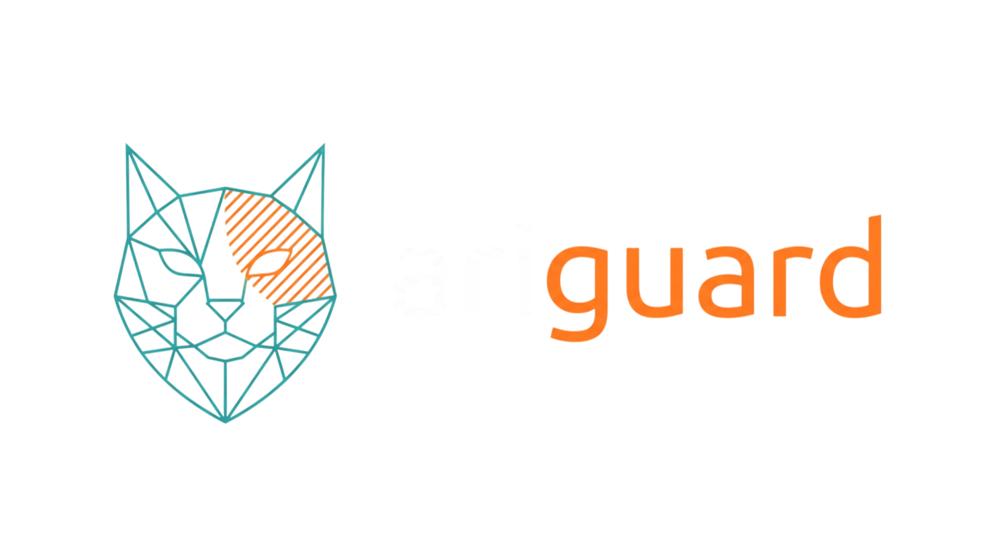
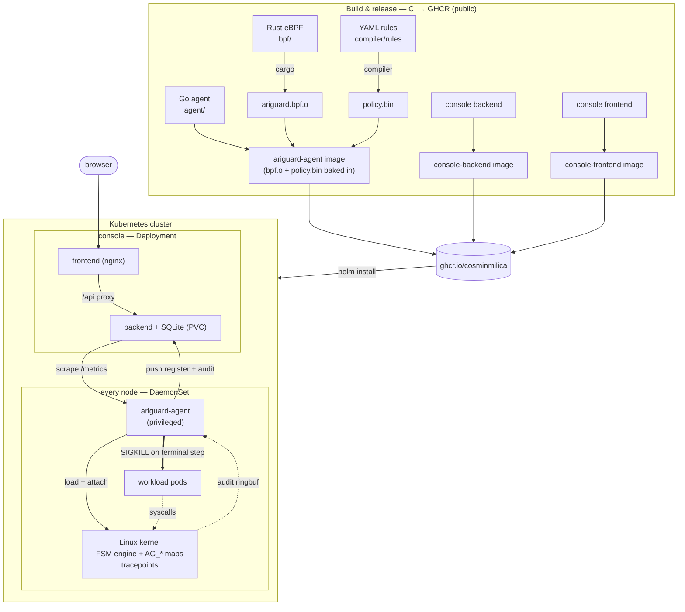

<p align="center">
  
</p>


> **In-kernel, zero-allocation threat mitigation.**
> AriGuard recognizes *multi-stage* attacks as they unfold inside the Linux kernel and blocks the critical step **synchronously** — before the payload executes.

[](#project-status)
[](#technology-stack)
[](#technology-stack)
[](#requirements)

---

## What is AriGuard?

Most runtime security tools (Falco, Tetragon) are **reactive** and **point-based**: they
observe a single syscall, ship the event to user space over a ring buffer, and *then*
decide what to do — by which time the payload has already run. They also reason about
**isolated events**, while real intrusions are **sequences**: recon → privilege
escalation → persistence → exfiltration. Any single step looks benign; the *chain* is the
attack.

AriGuard takes a different approach. It runs a **finite state machine entirely in the
kernel**. Syscalls are *transitions*; each process/container carries a *state*. When a
sequence advances to a compromised state, AriGuard mitigates **synchronously** from
inside the kernel (deny the syscall with `-EPERM`, kill, or quarantine) — on the hot path,
before the critical operation completes.

All kernel-side state lives in **pre-allocated eBPF maps**. There is **no dynamic
allocation on the data path**: a fixed, known memory budget and deterministic, bounded
latency regardless of load.

High-level threat intelligence (MITRE ATT&CK techniques, Sigma rules, labeled syscall
traces) is turned into the compact in-kernel transition tables by an offline **compiler**
(ML / LLM assisted) — so the kernel stays tiny and fast while the rules stay expressive.

---

## Why it's different

| | Falco / Tetragon (typical) | **AriGuard** |
|---|---|---|
| Detection unit | single event | **multi-stage sequence (FSM)** |
| Decision location | user space (async) | **in-kernel (synchronous)** |
| Reaction timing | after the event (ms) | **before the critical step (ns)** |
| Memory on data path | allocates / grows | **zero-allocation, fixed budget** |
| Rule updates | reload / restart | **hot map swap, no reload** |
| Enforcement | alert (mostly) | **alert → throttle → deny → kill** |

---

## How it works

### 1. The attack is a chain, not an event

Example: a container-escape kill chain modeled as an FSM. Each transition is a syscall
observed via kprobe/tracepoint/LSM hook.

```
 S0  normal
  │  openat / connect  ".../containerd.sock"   → runtime socket touched
  ▼
 S1  suspicious
  │  setns / unshare (mount/pid/user ns)       → namespace manipulation
  ▼
 S2  escalating
  │  mount (not propagation-only)              → host mount attempt
  ▼
 S3  breakout-imminent
  │  execve                                    → CRITICAL
  ▼
 S_COMPROMISED  ──►  MITIGATE  (deny -EPERM / SIGKILL / network quarantine)
```

A single `mount` or `setns` is normal in many workloads. The **ordered sequence** is what
trips the machine.

Each rule is one such chain. AriGuard runs **several rules at once**, each scoped to a
container (cgroup) or to a single process, and a syscall can advance more than one rule.
Bindings carry predicates on the syscall arguments (a path prefix, a flag mask), so a rule
fires on the real step and not on its benign look-alike — e.g. `mount` counts only when it
is not a propagation-only remount. Three rules ship today: container escape, reverse shell,
and fileless execution.

### 2. Dynamic, escalating mitigation

The response depends on the current state, not a static yes/no:

- **observe** — log to the audit ring buffer (early states)
- **throttle** — delay the syscall (mid states)
- **deny** — return `-EPERM` from an LSM hook (critical step)
- **kill / quarantine** — `SIGKILL` + drop the socket/traffic (compromised state)

### 3. Rules come from threat intelligence

The in-kernel transition table is produced offline and loaded into a BPF map:

- **ML path** — mine malicious subsequences from labeled syscall traces
  (e.g. ADFA-LD / LID-DS, plus synthetic attacks) and emit FSM transitions.
- **LLM path** — translate ATT&CK technique / Sigma descriptions in natural language
  into the formal state-transition representation.

The model/LLM runs **once, offline, at compile time** — never on the data path.

---

## Architecture

```
┌──────────────────────── USER SPACE ─────────────────────────────┐
│                                                                  │
│  Threat intel (ATT&CK / Sigma / labeled syscall traces)          │
│        │                                                         │
│        ▼                                                         │
│  compiler/  (Python, ML + LLM)                                   │
│        │   emits  transition table  +  mitigation policy         │
│        ▼                                                         │
│  control-plane/  (Go, controller-runtime)                        │
│        │   CRDs (ThreatPolicy), fleet mgmt, telemetry sink       │
│        ▼                                                         │
│  agent/  (Go, cilium/ebpf)   ── DaemonSet, one per node ──┐      │
│        │  load & attach programs, populate maps,          │      │
│        ▲  stream audit events                             │      │
└────────┼───────────────────────────────────────┬─────────┼──────┘
         │ map update (hot, no reload)            │ audit   │ attach
┌────────┼───────────────────────────────────────┼─────────┼──────┐
│        ▼                   KERNEL               │         ▼      │
│  ┌───────────────┐   ┌──────────────────┐   ┌──────────────────┐ │
│  │ kprobes /     │──►│  FSM ENGINE       │──►│  LSM hooks        │ │
│  │ tracepoints / │   │  bpf/ (Rust, Aya) │   │  deny / kill /    │ │
│  │ LSM entry     │   │  no_std, no alloc │   │  quarantine       │ │
│  └───────────────┘   └────────┬─────────┘   └──────────────────┘ │
│                               │                                  │
│   per-cgroup state  ◄─ HASH map   transition table ─► ARRAY map  │
│   lock-free counters ◄─ PERCPU map   audit stream ─► RINGBUF      │
└──────────────────────────────────────────────────────────────────┘
```

**The decision plane is 100% in-kernel.** User space only compiles rules, distributes
them, and collects audit telemetry — the inverse of the Falco model.

---

## Deployment

The eBPF object and the compiled rules are **baked into the agent image** — there is
no separate "BPF deployment". The agent runs as a privileged **DaemonSet** (one pod
per node) and, at startup, loads the object and attaches the programs into that node's
kernel, covering every pod on the node. One `helm install` brings up the agent and the
monitoring console; images are public on GHCR.



**Modes** are a kustomize overlay / Helm value: `detect` (observe only), `enforce`
(kill at the terminal step), and the console sink (`--sink-url`). The policy bundle can
be hot-swapped in place (SIGHUP) without reloading the programs.

## Zero-allocation design

The defining systems property. On the data path there is **no `malloc`, no GC, no
unbounded growth**. Everything is reserved at load time:

| Purpose | Map type | Notes |
|---|---|---|
| Per-cgroup / per-PID FSM state | `BPF_MAP_TYPE_HASH` (fixed) | O(1) lookup, capped entries |
| Transition table (state × event → next, action) | `BPF_MAP_TYPE_ARRAY` | hot-swappable from user space |
| Lock-free counters / metrics | `BPF_MAP_TYPE_PERCPU_ARRAY` | no cross-core contention |
| Audit / telemetry to user space | `BPF_MAP_TYPE_RINGBUF` | observability only, off the decision path |

**Consequences we will measure:** fixed memory budget independent of process count,
bounded per-event latency, and no in-kernel allocation-failure paths. The "memory vs.
number of processes" curve should be **flat** — that flat line is the headline result.

---

## Technology stack

| Layer | Choice |
|---|---|
| eBPF data plane | **Rust + [Aya](https://aya-rs.dev/)** (`aya-ebpf`, `no_std`, zero-alloc) |
| Kernel hooks | kprobes, tracepoints (`sys_enter_*`), **BPF LSM** (`lsm/*`) |
| Node agent / loader | **Go + [cilium/ebpf](https://github.com/cilium/ebpf)**, runs as a DaemonSet |
| Cluster control plane | **Go + controller-runtime** (CRDs, policy distribution) |
| Rule compiler | **Python** — sequence mining (ML) + optional LLM for NL→FSM |
| Local dev / demo | **Linux VM** (Lima / multipass) + **kind** single-node cluster |
| Datasets | ADFA-LD / LID-DS + synthetic scripted attacks |

> **Design note.** The eBPF objects are authored in Rust (`aya-ebpf`) but loaded by a Go
> agent (`cilium/ebpf`). The phase 0 gate confirmed this works unchanged with BTF-style
> maps; the shared layouts live in `bpf/ariguard-common` and are mirrored in `pkg/fsm`
> with size/offset tests. See [docs/architecture.md](docs/architecture.md).

---

## Repository layout

```
ariguard/
├── bpf/                      # eBPF data plane — Rust workspace (no_std, zero-alloc)
│   ├── ariguard-ebpf/       #   kernel programs: kprobes, tracepoints, LSM, FSM engine
│   └── ariguard-common/     #   shared ABI types (State/Event/Action, map layouts)
├── agent/                    # node DaemonSet — Go, cilium/ebpf
│   ├── cmd/ariguard-agent/
│   └── internal/{loader,mitigator,audit}/
├── control-plane/            # cluster operator — Go, controller-runtime
│   ├── cmd/ariguard-ctl/
│   ├── apis/v1alpha1/        #   CRDs: ThreatPolicy
│   └── controllers/
├── pkg/                      # shared Go libraries (used by agent + control-plane)
├── compiler/                 # threat-intel → FSM tables — Python (ML/LLM)
│   └── ariguard_compiler/{sigma,mine,emit}.py
├── proto/                    # gRPC contract (agent ↔ control-plane)
├── deploy/
│   ├── kind/                 # local single-node cluster
│   └── k8s/                  # DaemonSet + operator manifests
├── testdata/                 # benign + attack workloads, golden bundle, exit-check + checker
├── docs/                     # architecture.md, threat-model.md, ci-plan.md
├── go.mod                    # single Go module (covers agent/, control-plane/, pkg/)
└── Makefile                  # orchestrates the Rust / Go / Python toolchains
```

---

## Project status

Built in phases; **Phases 1–2 alone are a complete contribution**, Phase 3 is the
differentiator. The detailed plan and per-component tasks are in
[ROADMAP.md](ROADMAP.md) and each component's `TASKS.md`.

- [x] **Phase 0 — Spike:** Rust-eBPF object loads unchanged via the Go (`cilium/ebpf`) loader (BTF maps).
- [x] **Phase 1 — Passive FSM:** single-chain state machine in-kernel, detection only; exit check green on kind.
- [x] **Phase 1.5 — Generic engine:** many rules at once, per-container or per-process scope, argument predicates, 16 hooks; three rules (container-escape, reverse-shell, fileless-exec) detected together on kind; verifies on kernels 5.15 → stable.
- [ ] **Phase 2 — Synchronous mitigation:** LSM-based deny / kill / quarantine.
- [ ] **Phase 3 — Rule compiler:** threat intel → rules (ML, then LLM) + cluster distribution.
- [ ] **Phase 4 — Evaluation:** efficacy, latency, and the flat memory curve vs. Falco.

### What works today

A node agent loads the Rust eBPF object, compiles a set of YAML rules into one policy
bundle, and runs a generic multi-rule finite state machine entirely in the kernel. It
tracks each container (or process) through its own state per rule, recognizes three
multi-stage attack chains by the *ordered sequence* of syscalls (not single events),
attributes events to the Kubernetes pod, and streams an audit record on every transition.
Detection only — nothing is blocked yet (Phase 2). The per-program instruction count stays
under the 512 budget, memory is a fixed pre-allocated set of maps, and the end-to-end exit
check passes on kind with no false positives on the benign workloads or the node's own
runtime.

Tests: `pkg/fsm`, `compiler` and the agent packages are unit-tested; the kernel engine is
covered by an in-kernel integration test and the kind exit check. CI enforces a per-package
80% coverage floor (`make cover`).

---

## Requirements

- Linux kernel **≥ 5.7** with `CONFIG_BPF_LSM=y` (BPF LSM hooks)
- BTF-enabled kernel (`/sys/kernel/btf/vmlinux`) for CO-RE
- Rust toolchain + `bpf-linker`; Go ≥ 1.25; Python ≥ 3.11
- For local work on macOS: a Linux VM (Lima / multipass) + kind

## Quickstart

```sh
# host: bring up the Linux VM + kind cluster, export the kubeconfig
make dev-up            # Lima VM + kind; also runs `make kubeconfig`

# host: compile the rules into one policy bundle
make golden            # compiler/rules/*.yml -> testdata/golden/policy.bin

# in the VM (limactl shell ariguard), from the repo:
make build-bpf build-agent        # bin/ariguard.bpf.o + bin/ariguard-agent
sudo bin/ariguard-agent \
  --object bin/ariguard.bpf.o \
  --bundle testdata/golden/policy.bin \
  --kubeconfig ~/.kube/config     # streams audit JSON, detection only

# end-to-end: benign + attack workloads on kind, asserted by the checker
testdata/scripts/phase1-exit-check.sh
```

Blocking (`deny` / `kill`) is recorded but not yet enforced — that is Phase 2.

---

## Threat model & scope

**In scope:** detection and synchronous mitigation of multi-stage, syscall-observable
attack chains on a single node (container escape, local privilege escalation).

**Out of scope (for now):** kernel-exploit-based eBPF bypass, attacks that never touch the
monitored syscalls, cluster-wide correlation across nodes, and full MITRE ATT&CK coverage.
The engine is generic, but the shipped ruleset is **three well-chosen kill chains** to keep
the evaluation rigorous. Known false-positive risks and residual races are tracked in
[docs/threat-model.md](docs/threat-model.md).

---

## Academic context

AriGuard is the engineering artifact of a master's dissertation. Its contribution is
threefold: a **systems** contribution (a zero-allocation in-kernel state machine with
deterministic overhead), a **security** contribution (sequence-based synchronous
mitigation vs. event-based async alerting), and an **AI bridge** (compiling high-level
threat intelligence into low-level kernel detection).
