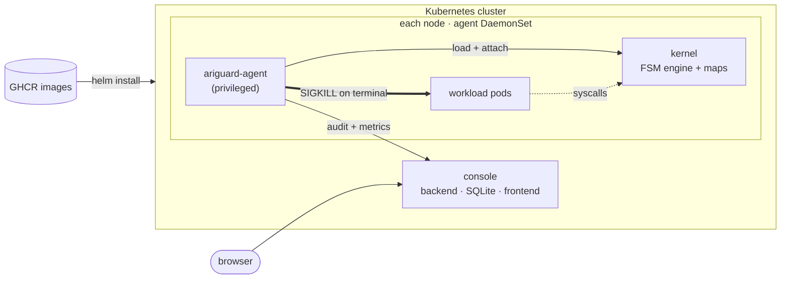

# Deployment & development

## How it deploys

The eBPF object and the compiled rules are **baked into the agent image** — there is no
separate "BPF deployment". The agent runs as a privileged **DaemonSet** (one pod per node)
and, at startup, loads the object and attaches the programs into that node's kernel,
covering every pod on the node. One `helm install` brings up the agent and the monitoring
console; images are published on GHCR.



**Modes** (a Helm value): `detect` observes only, `enforce` kills at the terminal step.
Policy can be hot-swapped in place (SIGHUP). The full chart and all values are documented in
[deploy/helm/ariguard](../deploy/helm/ariguard/README.md).

```sh
helm upgrade --install ariguard deploy/helm/ariguard -n ariguard-system --create-namespace
kubectl -n ariguard-system port-forward svc/ariguard-console-frontend 8080:80   # open http://localhost:8080
```

## Technology stack

| Layer | Choice |
|---|---|
| eBPF data plane | **Rust + [Aya](https://aya-rs.dev/)** (`aya-ebpf`, `no_std`, zero-alloc) |
| Kernel hooks | tracepoints (`sys_enter_*`); **BPF LSM** (`lsm/*`) for `-EPERM` deny (phase 2b) |
| Node agent / loader | **Go + [cilium/ebpf](https://github.com/cilium/ebpf)**, DaemonSet |
| Console | **Go + SQLite** backend, **Vue 3 + Vite** frontend |
| Cluster control plane | **Go + controller-runtime** (CRDs, distribution) — phase 3 |
| Rule compiler | **Python** — sequence mining (ML) + optional LLM for NL→FSM |
| Local dev / demo | **Linux VM** (Lima) + **kind** single-node cluster |

The eBPF objects are authored in Rust (`aya-ebpf`) but loaded by the Go agent
(`cilium/ebpf`); shared layouts live in `bpf/ariguard-common` and are mirrored in `pkg/fsm`
with size/offset tests. Design decisions are in [architecture.md](architecture.md).

## Repository layout

```
ariguard/
├── bpf/                      # eBPF data plane — Rust (no_std, zero-alloc)
│   ├── ariguard-ebpf/        #   kernel programs + FSM engine
│   └── ariguard-common/      #   shared ABI types / map layouts
├── agent/                    # node DaemonSet — Go, cilium/ebpf (loader, audit, sink, metrics, podsync)
├── console/                  # monitoring console — Go+SQLite backend, Vue frontend (separate module)
├── control-plane/            # cluster operator — Go (phase 3)
├── pkg/fsm/                  # shared Go ABI mirror (size/offset tests)
├── compiler/                 # threat-intel → FSM tables — Python (ML/LLM)
├── proto/                    # gRPC contract (agent ↔ control-plane)
├── deploy/
│   ├── docker/               # agent image Dockerfile
│   ├── kind/, lima/          # local cluster + VM
│   ├── k8s/                  # raw manifests (base + detect/enforce/console overlays)
│   └── helm/ariguard/        # umbrella chart (agent + console)
├── testdata/                 # benign + attack workloads, golden bundle, checker
├── docs/                     # how-it-works, deployment, architecture, threat-model
└── Makefile                  # Rust / Go / Python / Helm orchestration
```

## Requirements

- Linux kernel **≥ 5.7** with BTF (`/sys/kernel/btf/vmlinux`); `CONFIG_BPF_LSM=y` for the
  phase-2b `-EPERM` deny.
- Rust toolchain + `bpf-linker`; Go ≥ 1.27; Python ≥ 3.11.
- macOS dev: a Linux VM (Lima) + kind.

## Local quickstart (dev)

```sh
make dev-up                       # Lima VM + kind + kubeconfig
make golden                       # compiler/rules/*.yml -> testdata/golden/policy.bin
# in the VM (limactl shell ariguard), from the repo:
make build-bpf build-agent image kind-load
kubectl apply -k deploy/k8s/overlays/enforce     # or overlays/console to feed the console
testdata/scripts/phase1-exit-check.sh            # benign + attack workloads, asserted
```

CI gates (all green): `make ci` (hygiene, unit+coverage, contract, console, helm, security,
bpf), the kernel matrix 5.15→stable, and the kind e2e. See the Makefile `ci-*` targets.
